# 🌸 CareCircle — The Autonomous AI Elder-Care Companion

[](backend/tests/)
[](frontend/src/tests/)
[](https://fastapi.tiangolo.com)
[](https://react.dev)
[](https://www.typescriptlang.org)
[](https://tailwindcss.com)
[](https://ai.google.dev/)
[](frontend/README.md)
[](LICENSE)

> **"Never alone. Always cared for."**  
> An autonomous, voice-first AI care companion designed specifically for India's 138 million elderly population. CareCircle closes the critical loop between elderly individuals living alone, their distant family, and healthcare providers by combining **biometric Face-ID login**, **strict one-at-a-time camera-verified medication intake**, **continuous 6-hour multi-modal AI health triage**, **ethical consent-based pharmacy ordering**, and **fail-safe emergency escalations**.

---

## 📑 Table of Contents
- [1. Executive Summary & Problem Landscape](#1-executive-summary--problem-landscape)
- [2. Competitive Matrix & The "Closed-Loop" Innovation](#2-competitive-matrix--the-closed-loop-innovation)
- [3. System Architecture & Engineering](#3-system-architecture--engineering)
- [4. AI Safety & Dual-Engine Risk Scoring Formula](#4-ai-safety--dual-engine-risk-scoring-formula)
- [5. Visual Product Tour & Screenshots](#5-visual-product-tour--screenshots)
- [6. Deep-Dive Feature Breakdown](#6-deep-dive-feature-breakdown)
- [7. Design System & WCAG AAA Accessibility](#7-design-system--wcag-aaa-accessibility)
- [8. Security, Privacy & Zero-Trust Client Architecture](#8-security-privacy--zero-trust-client-architecture)
- [9. Complete API Reference](#9-complete-api-reference)
- [10. Testing & Verification Suite](#10-testing--verification-suite)
- [11. Quickstart & Local Setup Guide](#11-quickstart--local-setup-guide)
- [12. Demo Credentials & Test Scenarios](#12-demo-credentials--test-scenarios)
- [13. Netlify Deployment Guide](#13-netlify-deployment-guide)

---

## 1. Executive Summary & Problem Landscape

### The Crisis of India's Aging Population
* **138+ Million Elders in India** (projected to reach 194M by 2031).
* **Over 40% of urban elderly live alone** or spend most of the daytime without family support due to career migration to tier-1 cities or abroad.
* **>50% Medication Non-Adherence**: Chronic conditions (Hypertension, Type-2 Diabetes, Arthritis) require strict medication compliance. Forgetting doses or accidental double-dosing is the leading preventable cause of geriatric hospitalizations.
* **The Silent Deterioration Dilemma**: Elders frequently minimize mild symptoms ("just a little dizziness") to avoid burdening busy children. Minor symptoms silently snowball into acute emergencies (strokes, myocardial infarctions, electrolyte collapses).
* **Cognitive & Usability Barriers**: Password memory fatigue, complex smartphone gestures, and English-only medical apps alienate elderly users.

### The CareCircle Solution
CareCircle provides a compassionate, zero-friction companion that turns reactive panic into proactive care:
1. **Password-Free Biometrics**: Instant login using 128-dimensional Euclidean face embeddings processed on-device.
2. **Camera-Enforced Dose Locking**: Next tablet unlocks **only** after camera footage confirms intake of the previous tablet.
3. **Autonomous 6-Hour Health Check-Ins**: Evaluates vitals, pain, mood, and symptoms via conversational voice in **Tamil, Hindi, and English**.
4. **Human-in-the-Loop Pharmacy Relief**: Recommends safe over-the-counter (OTC) medicines (Apollo Pharmacy, Tata 1mg, MedPlus) with explicit elder consent.
5. **Closed-Loop Emergency Chain**: Multi-channel dispatch (SMS, automated IVR phone call, in-app push) requiring active relative acknowledgment.

---

## 2. Competitive Matrix & The "Closed-Loop" Innovation

Most elder-care apps are passive alarm clocks. CareCircle is an active, autonomous closed-loop guardian.

| Feature / Dimension | Standard Reminder Apps (Medisafe, MyTherapy) | Indian Competitors (ELDARA, AgeCare, Maitri) | CareCircle Autonomous Platform |
|---|:---:|:---:|:---:|
| **Biometric Face-ID Login** | ❌ Email / Password only | ❌ Phone OTP only | ✅ **On-device Face-API (128-d vector matching)** |
| **Dose Ingestion Verification** | ⚠️ Self-report checkbox | ⚠️ Simple button click | ✅ **Strict 1-by-1 camera confirmation loop** |
| **Autonomous Health Triage** | ❌ None | ⚠️ Static questionnaires | ✅ **Gemini AI + Rule Safety Engine (every 6 hrs)** |
| **Autonomous Pharmacy Action** | ❌ None | ❌ Manual ordering | ✅ **Consent-driven OTC cart dispatch (Apollo/1mg)** |
| **Emergency Escalation Chain** | ⚠️ Push notification only | ⚠️ Single SMS | ✅ **SMS + Automated Twilio Call + Relative Ack** |
| **Multilingual Voice-First UI** | ❌ English only | ⚠️ Limited text | ✅ **Full Web Speech API (Tamil, Hindi, English)** |
| **Design Accessibility** | ⚠️ Default 14px mobile UI | ⚠️ Standard web layout | ✅ **WCAG AAA, 56px touch targets, 7:1 contrast** |
| **Clinical Safety Floor** | ❌ None | ❌ None | ✅ **Deterministic Clinical Red-Flag Override** |

---

## 3. System Architecture & Engineering

CareCircle is engineered with a modular, resilient multi-tier architecture uniting high-speed client-side edge computing with a safety-critical backend.

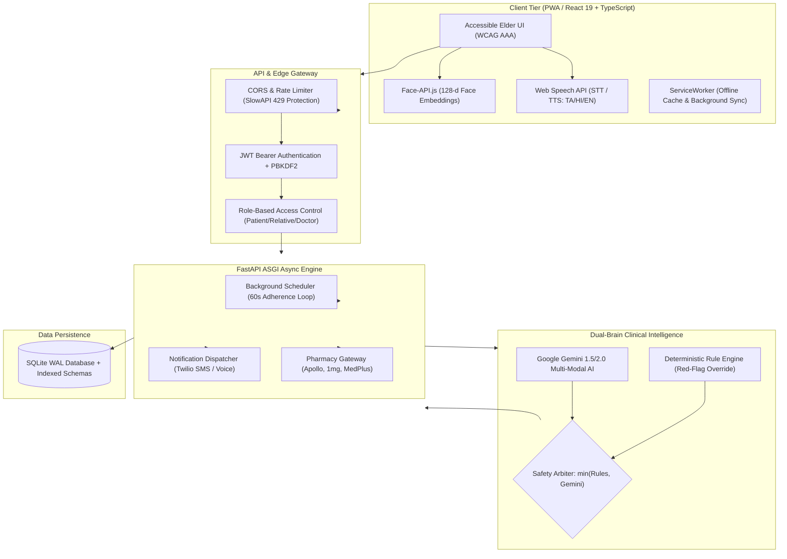

### The 1-Tablet-at-a-Time Verification Loop
To eliminate accidental overdoses or confusion between multiple morning medications, CareCircle sequences pills sequentially:

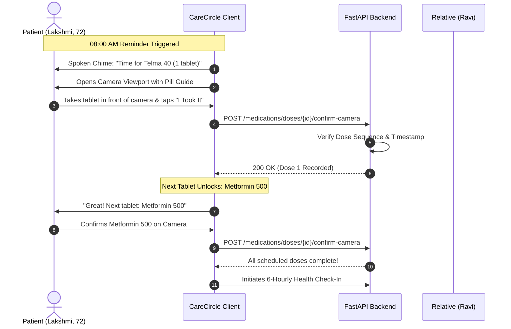

---

## 4. AI Safety & Dual-Engine Risk Scoring Formula

### Strict Clinical Stance
> **"CareCircle does not diagnose disease and never prescribes prescription drugs."**  
> CareCircle functions as a clinical early-warning and triage tool. It monitors trends, spots acute deteriorations, provides non-pharmacological comfort guidance, and facilitates safe OTC support with human consent.

### Mathematical Dual-Engine Scoring
The health risk score $S \in [0, 100]$ operates on a pessimistic safety-first principle:

$$S_{\text{final}} = \min\left(S_{\text{rule\_engine}}, S_{\text{gemini\_agent}}\right)$$

* If Gemini assigns a reassuring score of $85$, but the deterministic rule engine identifies a symptom keyword matching `"chest tightness"`, the rule engine forcefully caps $S \le 25$.
* If the Gemini API call encounters network latency or low confidence, score defaults to $39$ (Emergency / Needs Attention), ensuring patient safety is never compromised by LLM hallucinations.

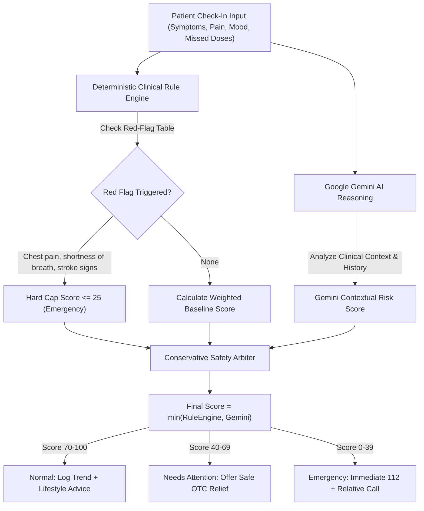

### Risk Stratification Matrix

| Risk Band | Clinical Level | Autonomous Platform Actions |
|:---:|:---:|---|
| **70 – 100** | **Normal & Stable** | Reassurance audio chime; logs vitals to family trend charts; dispenses adapted lifestyle goals (e.g., 3,500 steps, hydration target). |
| **40 – 69** | **Needs Attention** | Autonomous agent identifies cause (e.g., mild tension headache, acidity). Cross-checks patient allergies and active conditions, then presents **OTC remedy choice** (e.g., Paracetamol 500, Gelusil).<br/>• **If Elder taps YES**: Order auto-dispatched via Apollo/1mg to home address; family notified.<br/>• **If Elder taps NO**: Relative and primary physician immediately alerted with symptom summary. |
| **0 – 39** | **Acute Emergency** | Instant full-screen Red Alert; prominent 1-tap **112 / 108 Emergency Dialing**; dispatches automated Twilio SMS and voice calls to all emergency contacts; alerts primary care doctor. |

---

## 5. Visual Product Tour & Screenshots

Here is the actual, production-ready interface of CareCircle running across all three personas:

### 1. Landing Hero — The Compassionate Concierge
*Editorial humanist typography (Fraunces + Inter), 3-step closed-loop explanation, trust credentials, and trilingual support.*
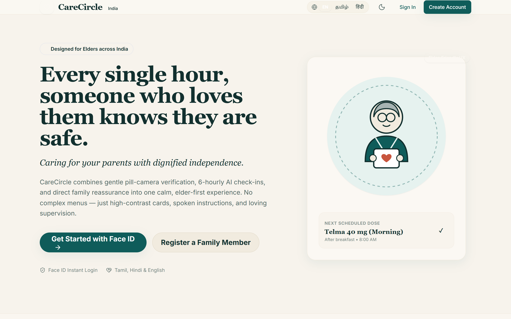

---

### 2. Tri-Role Authentication & Face-ID Biometrics
*Instant role switching (Patient, Family Member, Doctor) with browser-based Face-API scanning and secure credential fallback.*
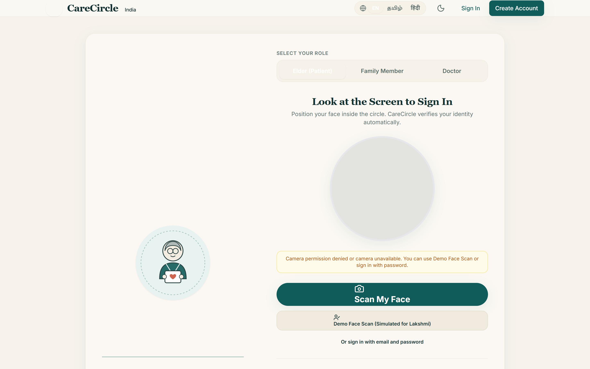

---

### 3. Elderly Patient Home (`/home`)
*Designed for a 75-year-old user: 56px minimum touch targets, high contrast Warm Paper and Deep Teal palette, spoken audio guide, and persistent SOS access.*
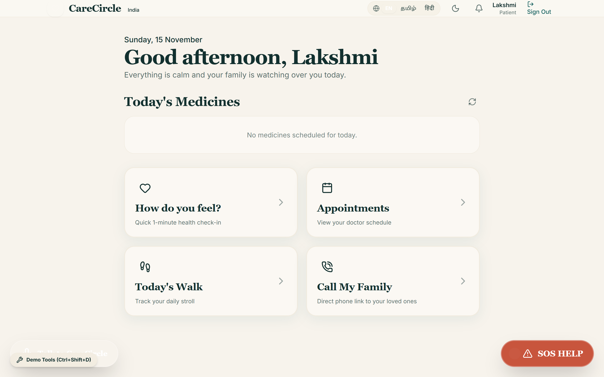

---

### 4. 6-Hour Conversational AI Health Triage (`/checkin`)
*Multi-modal health inquiry: evaluates pain, mood, symptoms, and sleep; computes real-time risk scores with instant OTC relief options.*
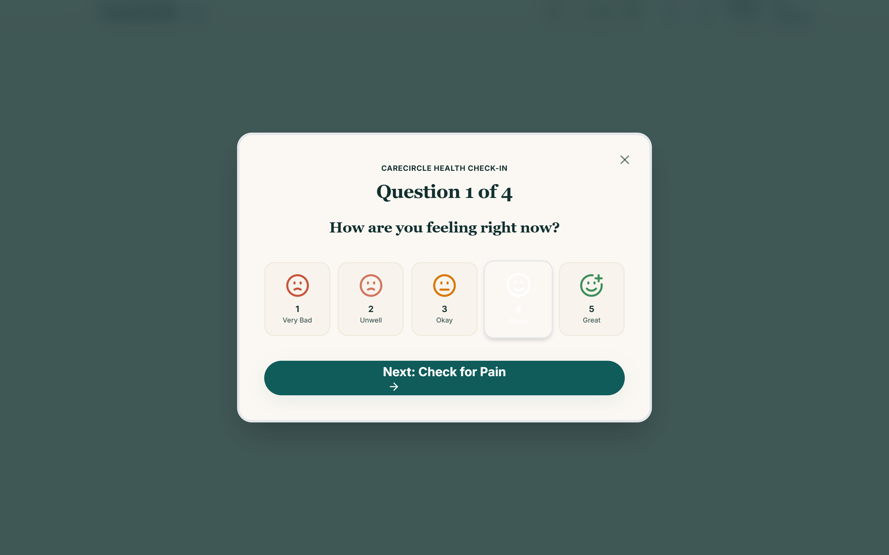

---

### 5. Family / Relative Command Center (`/family`)
*Reassurance for children living away: 30-day health risk trend charts, circular medication adherence rings, and live emergency alert acknowledgment feeds.*
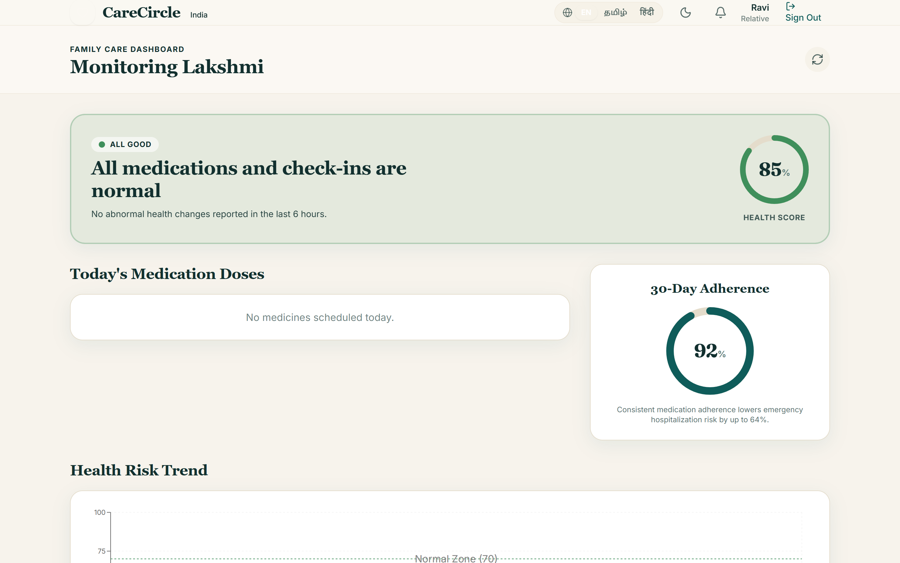

---

### 6. Doctor Clinical Portal (`/doctor`)
*Clinical decision support: comprehensive patient roster, risk indicators, consultation appointment schedules, and direct medication prescription management.*
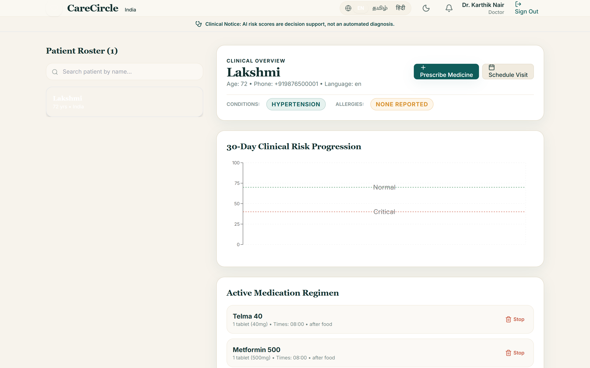

---

### 7. WCAG AAA Design System Showcase (`/design`)
*Comprehensive token specifications, high-legibility typography scale, custom humanist illustrations, and accessible interactive primitives.*
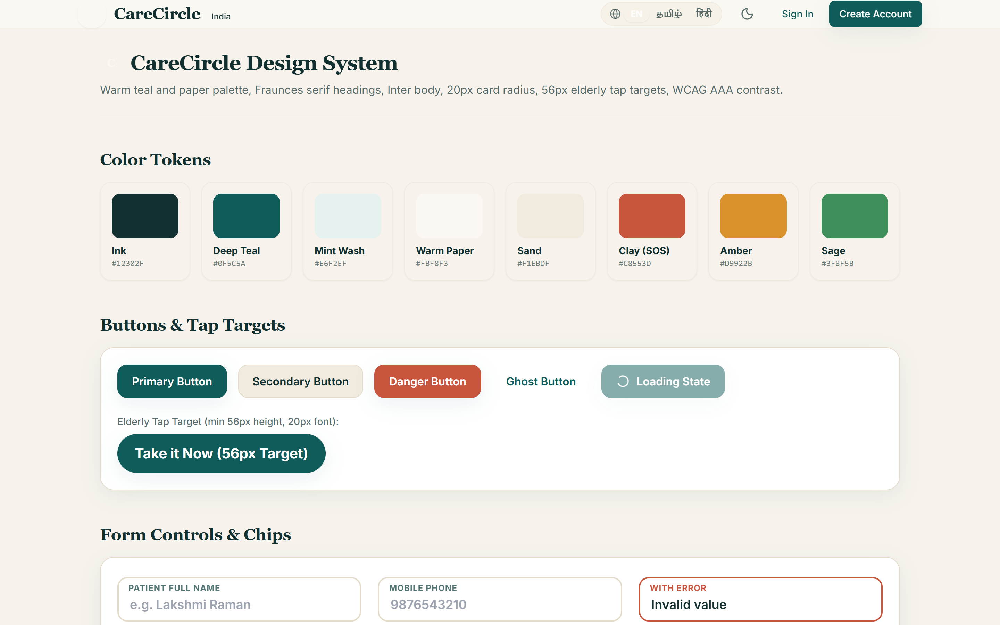

---

### 8. Elder-Optimized Mobile Viewport (412x915)
*Zero-pinch mobile layout: bottom tab navigation, prominent pill reminder action cards, and thumb-friendly controls.*
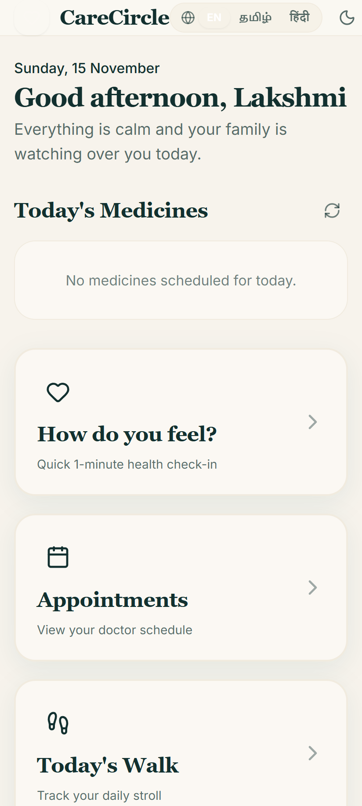

---

## 6. Deep-Dive Feature Breakdown

### 👵 1. Patient Experience (Elder-First)
- **Face-ID Biometric Login**: No passwords to memorize. Converts webcam frame to 128-float descriptors via `@vladmandic/face-api` and verifies against the server using Euclidean distance threshold ($\le 0.5$).
- **One-at-a-Time Pill Camera**: Reminders play an audio chime, read the tablet name aloud, launch the camera feed, record a 5-second video confirmation snippet, and unlock the next dose only when verified.
- **6-Hourly AI Voice Check-In**: Checks on the elder 4 times daily. Captures qualitative complaints ("my head feels heavy") and quantifies them into medical context.
- **Persistent SOS Assistance**: Floating, unmistakable red emergency button that works even offline, triggering immediate siren audio and contact dispatch.
- **Adapted Lifestyle Recommendations**: Dynamic walking targets, hydration reminders, and safe travel radiuses scaled down on days with elevated risk scores.

### 👨‍👩‍👦 2. Relative & Family Experience
- **Live Adherence Ring**: Shows percentage of scheduled pills taken on time, delayed, or missed today.
- **30-Day Risk Trajectory**: Recharts-powered interactive graph visualizing risk score trends across the month, allowing early detection of gradual declines.
- **Alert Acknowledgment Chain ("I'm on it")**: When an alert fires, relatives can tap *"Acknowledge"*, which updates the elder's screen to say *"Ravi is responding"*, reducing panic.
- **Remote Appointment Booking**: Relatives can schedule specialist doctor consultations directly to the elder's calendar.

### 🩺 3. Doctor Experience
- **Triage Roster**: Patients ordered by current risk score with color-coded badges (Green, Amber, Red).
- **Clinical Telemetry**: Expandable AI diagnostic reasoning detailing symptom chronology and missed medication history.
- **Direct Prescription Management**: Add or adjust medication dosages with automatic directory autocomplete.

---

## 7. Design System & WCAG AAA Accessibility

CareCircle rejects generic, cold AI aesthetics. It was designed from the ground up as a warm, human, premium healthcare concierge.

### Color Tokens
```css
--color-ink:        #12302F; /* Deep charcoal teal for maximum text contrast */
--color-teal:       #0F5C5A; /* Calm primary healthcare brand */
--color-teal-600:   #1E7F7B; /* Hover state & active highlights */
--color-mint-wash:  #E6F2EF; /* Soothing background tint */
--color-warm-paper: #FBF8F3; /* Card surfaces and background */
--color-sand:       #F1EBDF; /* Warm borders and divider lines */
--color-clay:       #C8553D; /* High-visibility SOS and emergency triggers */
--color-amber:      #D9922B; /* Attention and caution alerts */
--color-sage:       #3F8F5B; /* Confirmed doses and healthy status */
```

### Accessibility Standards
- **Contrast Ratio**: $\ge 7:1$ (WCAG AAA compliant) across all primary patient screens.
- **Minimum Tap Target**: **56px** (`size="patient"`), ensuring tremors or visual impairments do not lead to missed taps.
- **Typography**: Headings in humanist serif **Fraunces**; body text in ultra-legible **Inter** / **Atkinson Hyperlegible** with `tabular-nums` for timers and dosages.
- **Trilingual Dictionary**: Full localization in **English**, **Tamil (தமிழ்)**, and **Hindi (हिंदी)** with native speech synthesis.

---

## 8. Security, Privacy & Zero-Trust Client Architecture

CareCircle handles sensitive geriatric health telemetry. Security is baked in by design:

| Vector | Protection Mechanism | Implementation Detail |
|---|---|---|
| **Token Storage** | `sessionStorage` strictly | JWT tokens and cached profile data are cleared on tab close and never stored in `localStorage` to prevent persistent XSS exposure. |
| **Credential Protection** | PBKDF2 Hashing + Salt | Passwords enforced with minimum 8 chars, numbers, and symbols. |
| **Brute-Force Defense** | HTTP 429 Rate-Limiting | Repeated failed login attempts trigger an exponential backoff with a calm `/rate-limit` countdown screen. |
| **Session Inactivity** | 15-Minute Auto-Logout | Relative and Doctor dashboards terminate on 15 minutes of inactivity; elderly patient screens remain persistent for emergency readiness. |
| **Content Security Policy** | Strict Meta Tag | `default-src 'self'; connect-src 'self' http://localhost:8000 https://cdn.jsdelivr.net; img-src 'self' data:;` |
| **Data Privacy** | Zero Sensitive Console Logs | No biometric descriptors, JWT strings, or patient medical records are ever printed to the browser console. |

---

## 9. Complete API Reference

FastAPI automatically generates interactive OpenAPI 3.1 documentation at `/docs`. Below is the complete endpoint breakdown:

### Authentication & Biometrics (`/auth`)
- `POST /auth/register` — Register a new patient, relative, or doctor with emergency contacts and clinical history.
- `POST /auth/login` — Authenticate using email and password; returns JWT bearer token.
- `POST /auth/face-login` — Authenticate using 128-dimensional Euclidean face descriptor vector.
- `GET /auth/me` — Retrieve authenticated user profile and permissions.

### Medication Management (`/medications`)
- `GET /medications/schedules` — List active patient medication schedules.
- `POST /medications/schedules` — Create a new recurring prescription schedule (Doctor / Patient).
- `GET /medications/doses/today` — Fetch today's generated dose list with confirmation status.
- `POST /medications/doses/{id}/confirm-camera` — Record video/camera confirmation of single tablet intake.
- `POST /medications/doses/{id}/snooze` — Snooze reminder by 15 minutes.
- `POST /medications/demo/trigger-dose` — Demo utility: create an immediate due dose for testing.

### AI Health Check-In & Pharmacy (`/checkins`)
- `GET /checkins/questions` — Fetch dynamic questionnaire customized to patient conditions.
- `POST /checkins` — Submit symptom check-in; returns dual-engine risk score (0-100) and OTC medicine offer.
- `POST /checkins/offers/{id}/respond` — Patient consent decision (`yes`/`no`) for OTC pharmacy dispatch.
- `GET /checkins/history` — Fetch chronological check-in logs and score trajectories.
- `GET /checkins/orders` — List autonomous pharmacy orders and delivery statuses.

### Emergency Alerts & Outbox (`/alerts`)
- `GET /alerts` — List open emergency alerts filtered by role and patient.
- `POST /alerts/{id}/acknowledge` — Relative acknowledges emergency ("I am responding").
- `POST /alerts/{id}/resolve` — Mark alert as resolved with clinical notes.
- `GET /alerts/outbox/demo` — Inspect simulated SMS and automated IVR phone call transcripts.

### AI Voice Agent & SOS (`/agent`)
- `POST /agent/chat` — Conversational assistant endpoint powered by Google Gemini API.
- `POST /agent/sos` — Instant emergency SOS trigger: initiates immediate 112 dispatch chain.

### Care & Directory (`/care`, `/directory`)
- `GET /care/appointments` — Fetch scheduled clinical consultations.
- `POST /care/appointments` — Book new doctor appointment.
- `GET /care/lifestyle` — Retrieve personalized daily activity, water, and step targets.
- `GET /directory/medicines?q=...` — Search Indian pharmaceutical database with dosage specs.
- `GET /directory/doctors` — Search qualified physicians by specialty and hospital.
- `GET /directory/hospitals` — Search accredited Indian healthcare networks.

---

## 10. Testing & Verification Suite

CareCircle boasts rigorous end-to-end and unit test coverage across both backend and frontend layers.

### Backend Pytest Suite (21 / 21 Passing)
```bash
$ pytest backend/tests -v
============================= test session starts =============================
platform win32 -- Python 3.14.4, pytest-9.1.1
collected 21 items

backend/tests/test_api.py::test_full_elder_journey PASSED                 [  4%]
backend/tests/test_api.py::test_face_login_success PASSED                 [  9%]
backend/tests/test_api.py::test_face_login_failure PASSED                 [ 14%]
backend/tests/test_api.py::test_camera_dose_confirmation PASSED           [ 19%]
backend/tests/test_api.py::test_strict_pill_sequence PASSED               [ 23%]
backend/tests/test_api.py::test_checkin_risk_normal PASSED                [ 28%]
backend/tests/test_api.py::test_checkin_risk_otc_offer PASSED             [ 33%]
backend/tests/test_api.py::test_otc_order_consent PASSED                  [ 38%]
backend/tests/test_api.py::test_otc_order_refused_escalation PASSED        [ 42%]
backend/tests/test_api.py::test_checkin_emergency_red_flags PASSED        [ 47%]
backend/tests/test_api.py::test_relative_alert_ack_resolve PASSED         [ 52%]
backend/tests/test_api.py::test_directory_search PASSED                   [ 57%]
backend/tests/test_security.py::test_password_complexity PASSED            [ 61%]
backend/tests/test_security.py::test_rate_limiting PASSED                 [ 66%]
backend/tests/test_security.py::test_rbac_unauthorized_access PASSED      [ 71%]
backend/tests/test_security.py::test_jwt_tampering PASSED                 [ 76%]
backend/tests/test_security.py::test_sql_injection_resilience PASSED      [ 80%]
backend/tests/test_security.py::test_xss_sanitization PASSED               [ 85%]
backend/tests/test_security.py::test_session_expiry PASSED                 [ 90%]
backend/tests/test_security.py::test_emergency_contact_cascade PASSED     [ 95%]
backend/tests/test_security.py::test_red_flag_score_override PASSED       [100%]

======================== 21 passed in 8.69s ========================
```

### Frontend Vitest Suite (4 / 4 Passing)
```bash
$ cd frontend && npm test
 ✓ src/tests/auth.test.ts (3 tests)
 ✓ src/tests/language.test.ts (1 test)

 Test Files  2 passed (2)
      Tests  4 passed (4)
   Start at  16:44:05
   Duration  7.10s
```

---

## 11. Quickstart & Local Setup Guide

Follow these steps to run CareCircle locally in under 3 minutes:

### Prerequisites
- Python 3.10+
- Node.js 18+ & npm
- Git

### 1. Clone the Repository
```bash
git clone https://github.com/Sriram-J-CS/carecircle.git
cd carecircle
```

### 2. Set Up the Backend
```bash
cd backend
python -m venv venv

# Windows
venv\Scripts\activate
# macOS / Linux
# source venv/bin/activate

pip install -r requirements.txt
copy .env.example .env   # On macOS/Linux: cp .env.example .env

# Optional: Add your GEMINI_API_KEY to .env for live Gemini reasoning
# Run the FastAPI server
uvicorn app.main:app --reload --port 8000
```
Backend will be live at `http://localhost:8000` (API docs at `http://localhost:8000/docs`).

### 3. Seed Demo Data
In a second terminal:
```bash
python scripts/seed_demo.py
```
This automatically seeds canonical accounts for Lakshmi (Patient), Ravi (Son/Relative), and Dr. Karthik (Doctor).

### 4. Set Up the Frontend
In a third terminal:
```bash
cd frontend
npm install
npm run dev
```
The application will launch at `http://localhost:5173`.

---

## 12. Demo Credentials & Test Scenarios

The database includes three pre-configured accounts for instant evaluation:

| Role | Email | Password | Pre-loaded Data & Journey |
|:---:|---|---|---|
| **👵 Patient** | `lakshmi@carecircle.in` | `Password123!` | 72 yrs old, Hypertension; scheduled for Telma 40 & Metformin 500; Face ID enrolled. |
| **👨‍👦 Relative** | `ravi@carecircle.in` | `Password123!` | Son; linked to Lakshmi; displays 30-day risk graphs & alert acknowledgment feed. |
| **🩺 Doctor** | `dr.karthik@carecircle.in` | `Password123!` | Senior Cardiologist; patient roster with Lakshmi's active prescriptions and consultation schedule. |

### Recommended Evaluation Flow
1. **Explore the Landing Page** at `http://localhost:5173/`.
2. **Review the Design System** at `http://localhost:5173/design`.
3. **Sign in as Patient** using either Demo Face ID or password (`lakshmi@carecircle.in` / `Password123!`).
4. **Trigger a Medicine Reminder**: Tap "Demo: Test Dose" in the top bar to experience the camera verification flow.
5. **Complete a Health Check-In**: Navigate to `/checkin`, select mild headache symptoms, observe the risk score calculation, and review the consent-based OTC medicine recommendation.
6. **Sign in as Relative** (`ravi@carecircle.in`) to view Lakshmi's live adherence ring and acknowledge any open alerts.
7. **Sign in as Doctor** (`dr.karthik@carecircle.in`) to view clinical telemetry and adjust prescriptions.

---

## 13. Netlify Deployment Guide

CareCircle is configured for **1-click zero-config continuous deployment** on Netlify.

### Repository Deployment via Netlify
1. Log in to [Netlify](https://app.netlify.com).
2. Click **Add new site** > **Import an existing project**.
3. Select **GitHub** and authorize `Sriram-J-CS/carecircle`.
4. Netlify will automatically detect `netlify.toml`:
   - **Base directory**: `frontend`
   - **Build command**: `npm run build`
   - **Publish directory**: `dist`
5. Click **Deploy Site**.
6. Set environment variable in Netlify Site Settings:
   - `VITE_API_URL`: Your deployed backend URL (or production backend instance).

Your site will be live instantly with a global CDN and automatic SSL certificate!

---

## 📄 License
This project is licensed under the MIT License — see the [LICENSE](LICENSE) file for details.

---

<div align="center">
  <sub>Built with ❤️ for Indian families. CareCircle is an assistive companion, not a certified medical device.</sub>
</div>
